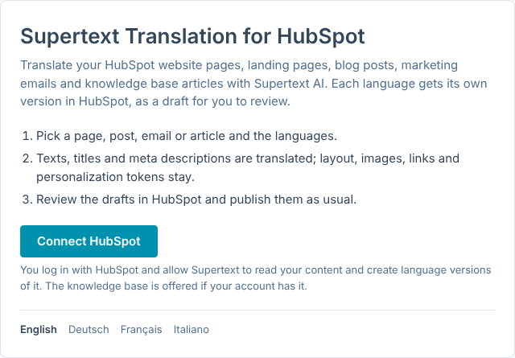
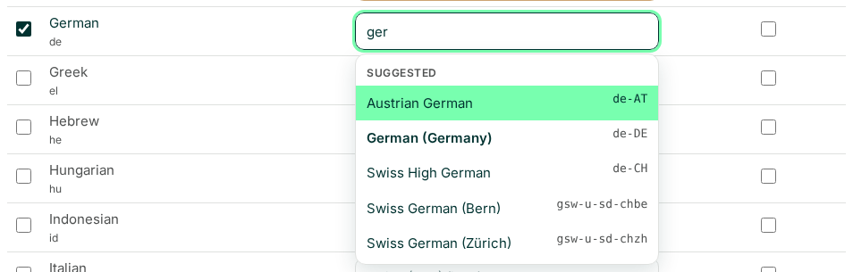

# Installation guide — Supertext Translation for HubSpot

For HubSpot super admins and administrators setting up Supertext Translation.

> **Status: tested on a real HubSpot account** (installing, blog posts). It isn't in the HubSpot App Marketplace yet, and website pages, landing pages, emails and the knowledge base haven't been tried on a real account yet. Ask Supertext before using it on a live website.

## How it works

Supertext Translation is an app that runs on Supertext's servers and connects to your HubSpot account. For each item you translate, it makes one **version per language** in HubSpot, saved as a **draft**, with the texts translated by Supertext AI:

| Content | What the app makes |
| --- | --- |
| Website pages, landing pages | A language variant of the page in HubSpot's multi-language group (the same as *Create a new language variation* in HubSpot), its draft written |
| Blog posts | A language variant of the post, in the blog's variant for that language |
| Marketing emails | A copy of the email per language (*Autumn newsletter · DE-CH*), with the language set |
| Knowledge base articles | A translation of the article, linked to it (Service Hub Professional or Enterprise) |

You review the drafts in HubSpot and publish or send them as usual. The app never publishes or sends anything and never changes the original.

## Requirements

| | |
| --- | --- |
| HubSpot | A HubSpot account with Content Hub or Marketing Hub. Multi-language pages and blogs need Professional or Enterprise; the knowledge base needs Service Hub Professional or Enterprise. You install the app as a **super admin** (or a user with the *App Marketplace access* permission). |
| Languages in HubSpot | Pages, posts and emails carry a language in HubSpot (page settings → *Language*). For blog posts, the blog needs a language variant for each target language: HubSpot → Settings → Content → Blog → *Add blog language variation*. |
| Supertext | An account with an API key, see [step 1](#1-get-a-supertext-account-and-api-key) |

## 1. Get a Supertext account and API key

1. **Account:** no Supertext account yet? [Log in or create one](https://www.supertext.com/person/en/account/signin) with your email address.
2. **API key:** generate it at [supertext.com → Integrations → API](https://www.supertext.com/en/integrations/api). Only users with the **Admin** role in the Supertext account can do this; otherwise ask your Supertext account admin for a key.

The app's settings page links to both, next to the API key field.

## 2. Install the app in HubSpot

Open the app (Supertext sends you its address until it is listed in the HubSpot App Marketplace) and click **Connect HubSpot**. The page is in your browser's language; the links at the bottom switch to English, German, French or Italian. HubSpot asks you to choose the account and to allow *Supertext Translation* to access your content; confirm. If your account has the knowledge base, HubSpot also offers access to it. You come back to the app's settings.

The app asks HubSpot for:

| Scope | Why |
| --- | --- |
| `content` | Read website pages, landing pages, blog posts and marketing emails, and create their language versions as drafts |
| `cms.knowledge_base.articles.read`, `cms.knowledge_base.articles.write` (optional) | Read knowledge base articles and create their translations. Left out if the account doesn't have the knowledge base. |

Everyone in your team who connects the same HubSpot account shares its settings. The connection stays until you disconnect it in the app or uninstall the app in HubSpot (Settings → Integrations → Connected apps).

## 3. Settings

Enter the API key, choose your languages and click **Save**. Saving checks the API key automatically (free of charge, nothing is translated) and shows the result under the key: *API key checked: the connection to Supertext works.* means everything is in place. **Test connection** runs the same check again, also for a key you have typed but not saved yet.

| Setting | Default | Purpose |
| --- | --- | --- |
| API key | – | Your Supertext key, with or without the `Supertext-Auth-Key` prefix; stored encrypted. *Remove the saved key* deletes it. |
| Test connection | – | Checks the key (entered or saved) with Supertext, without translating anything. The result of the saved key's check is shown under the key with its time (UTC). |
| Language of your content | English | Used for items that have no language set in HubSpot (HubSpot needs it to make a language variant). Items that have one are translated from their own language. *Let Supertext detect it* lets Supertext find the language, but pages without a language then can't get variants. |
| Translate into | none | The languages to translate into, as HubSpot codes (`de-ch`, `fr`, `en-gb` …): use the same languages as your website and blog variants in HubSpot. |
| Supertext code | the suggestion (see below) | The language mapping: the code Supertext uses for this HubSpot language, chosen from a searchable dropdown of Supertext's languages: click it and type part of a name or code (`germ`, `de-ch`, `chin`), then pick one with a click or Enter (name and code, e.g. *Swiss High German (de-CH)*; the variants of the same language first, e.g. for German `de-CH`, `de-DE`, `de-AT` and Swiss German for Zürich and Bern). German, English, French, Italian and Portuguese have a region (`de-CH`, `de-DE`, `de-AT`, `en-US`, `en-GB`, `fr-CH`, `fr-FR`, `it-CH`, `it-IT`, `pt-BR`, `pt-PT`), Chinese and Serbian a script (`zh-Hans`, `zh-Hant`, `sr-Latn`, `sr-Cyrl`), Norwegian is `nb`; the others are the bare language (`es`, `nl`, `sl` …). Until you save a code, each dropdown preselects a suggestion, and a language nobody saved is translated with it: the same code where HubSpot's code is a Supertext code as it is (`de-ch` → `de-CH`, `es`, `nl`), else the default in the table below. A language with neither shows *— choose —* in orange, isn't translated (*has no Supertext code yet*) and the page warns about it while it is ticked. Saving stores the code shown in every dropdown. A code Supertext doesn't offer isn't saved (*Saved, except these codes …*). The same mapping gives the source language (`en-us` is sent as the source `en`). |
| Form of address | Let Supertext decide | *Formal* (German "Sie", French "vous") or *Informal* ("du", "tu"). Sent only for languages where Supertext offers it; the page names the ticked languages that don't have it, which are translated with Supertext's default. |
| Send version information to Supertext | On | See *Version information* below. |
| Interface language | Automatic | The language of the app's own pages: your browser's language, or English, Deutsch, Français or Italiano. Saved for this browser only, so each colleague can choose their own; it doesn't change which languages your content is translated into. |

Suggestions for HubSpot languages without an exact Supertext code (the Supertext SDK's defaults):

| HubSpot code | Suggested Supertext code |
| --- | --- |
| `de`, `en`, `fr`, `it`, `pt` | `de-DE`, `en-US`, `fr-FR`, `it-IT`, `pt-PT` |
| `zh-cn` / `zh-hk`, `zh-tw` | `zh-Hans` / `zh-Hant` |
| `sr` | `sr-Latn` |
| `es-mx`, `nl-be` (a region of a language Supertext offers without one) | `es`, `nl` |
| `en-au`, `en-ca`, `fr-be`, `fr-ca`, `no`, and languages Supertext doesn't offer (`ar`, `he`, `ro`, `uk`, `vi` …) | none: *— choose —* (choose one, e.g. `en-GB` for `en-au`, `fr-FR` for `fr-be`, `nb` for `no`) |

The settings page also shows whether the knowledge base is connected and the app's version, linked to its release notes.

## Version information

With **Send version information to Supertext** on, the app sends a short report to Supertext's support center (the Commando Center) when you save the settings, on the first visit to the app after connecting, after the app or Node.js was updated, and when the result of the API key check changes (for example a key Supertext rejects during a translation). It contains:

- the HubSpot account's ID as an address, `https://app.hubspot.com/settings/<account ID>` (an account may have several websites or none; no account name, domain, login or e-mail address);
- the app's name (`HubSpot-Supertext-Translation`) and version, `HubSpot`, and the Node.js and Supertext SDK versions;
- whether an API key is set and the result of the key check (`ok`, `invalid`, `missing`, `unreachable` or `error`, with the time and Supertext's HTTP status).

No content, no API key and no personal data. Being a hosted app, it has no ping address and sends no callback URL. Turn it off by unticking the setting and saving: then nothing at all is sent. Supertext can turn it off for all accounts on the server with `SUPERTEXT_VERSION_REPORTS=0` (the checkbox then can't be changed). The API key check itself runs either way.

## Who can translate

Everyone who has connected the HubSpot account in the app. The app acts with the access you granted at install, not with each person's HubSpot permissions.

## Updating

Nothing to do: the app runs on Supertext's servers and is updated there. The settings page shows the current version.

## Disconnecting

**Settings → Disconnect HubSpot** deletes your settings, the stored tokens and API key and the list of translations. Language versions already made stay in HubSpot. To also remove the app from HubSpot, uninstall it in HubSpot under Settings → Integrations → Connected apps. If you only uninstall it there, the app notices on the next page you open and asks you to connect again.

## Troubleshooting

| Message | Cause / fix |
| --- | --- |
| *Your session has expired* | Connect HubSpot again on the start page. |
| *HubSpot access wasn't granted* | You declined on HubSpot's page. Click **Connect HubSpot** again. |
| *HubSpot refused the connection* | The app was uninstalled in HubSpot, or its access was revoked. Connect again. |
| *HubSpot refused the request …* | The account's subscription doesn't include this kind of content (for example multi-language pages without Professional), or the app lacks the scope. HubSpot's own message is shown in brackets. |
| *The knowledge base isn't connected* | The account has no Service Hub Professional or Enterprise, or the knowledge base access was left out at install. Connect HubSpot again and allow it. |
| *The blog has no “fr-ch” version in HubSpot yet …* | Add a language variation of the blog for that language in HubSpot (Settings → Content → Blog), then translate again. The app checks this with HubSpot before translating, so nothing is sent to Supertext for that language. |
| *The item has no language in HubSpot …* | Set the page's language in HubSpot (page settings), or set *Language of your content* under Settings. |
| *Add your Supertext API key* / *No Supertext API key configured* | Enter the key under Settings (step 3). |
| *API key checked: the connection to Supertext works.* | All good. |
| *Supertext rejected the API key …* | The saved key is wrong or revoked: copy the whole key again, or generate a new one at [supertext.com → Integrations → API](https://www.supertext.com/en/integrations/api) (Admin role required). No Supertext account yet? Create one at [supertext.com](https://www.supertext.com/person/en/account/signin). |
| *No API key is set yet …* | Enter the key under Settings and save. |
| *The API key couldn't be checked because Supertext can't be reached* | A network problem or a Supertext outage; the settings are saved. Click **Test connection** later. |
| *The API key couldn't be checked: Supertext answered with an error (…)* | Supertext answered unexpectedly (the HTTP status is shown); the settings are saved. Try again later and contact Supertext support if it stays. |
| *Authentication failed* | The key is wrong or revoked. Check it with **Test connection**; if needed, generate a new one at [supertext.com → Integrations → API](https://www.supertext.com/en/integrations/api) (Admin role required). |
| *Choose your languages* | No languages are ticked under Settings → Languages. |
| *These languages have no Supertext code yet …* / *The language “fr-be” has no Supertext code yet, so nothing was sent* | Choose the language's code in its *Supertext code* dropdown under Settings → Languages (it shows *— choose —*), for example `fr-FR` for `fr-be` (`unsupported_language`: nothing is sent to Supertext for that language until it has one). |
| *Supertext doesn't know … as the language of your content* | Enter that language's Supertext code (e.g. `en-US` for English) or choose *Let Supertext detect it*. |
| *Saved, except these codes, which aren't Supertext codes …* | Pick a code from the dropdown (e.g. `de-CH`, `es`, `zh-Hans`). |
| *Supertext offers no formal or informal address for this language* | Set the form of address to *Let Supertext decide*. |
| *Supertext doesn't translate into …* | Check the language's Supertext code under Settings → Languages. |
| *Too many requests to Supertext / HubSpot* | The rate limit was still exceeded after 4 automatic retries. Wait a moment and start again. |
| *Your Supertext translation limit is exceeded* | Your Supertext plan's volume is used up. |
| *The app restarted during the translation* | Start the translation again; languages already done are kept. |

## Privacy and security

- The texts you translate are sent to Supertext (api.supertext.com) and deleted there right after download (they expire after 24 hours anyway).
- The app stores per HubSpot account: the account's ID and domain, the granted scopes, the OAuth tokens and the Supertext API key (both encrypted), the settings above, which email copy belongs to which email and language (and the IDs of the other versions it made), and the list of recent translations (item names and results). It doesn't store your content or any contact data.
- With *Send version information to Supertext* on, the reports described under *Version information* go to Supertext's support center; never content, the API key or personal data.
- The app reads content and creates and edits drafts of language versions. It never publishes a page or post and never sends an email.
