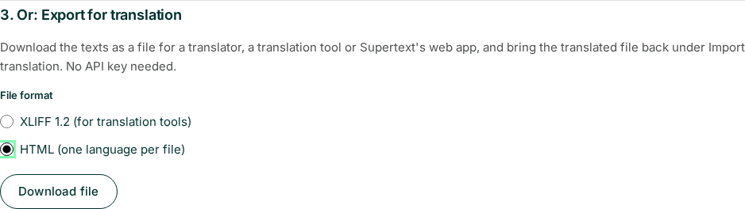
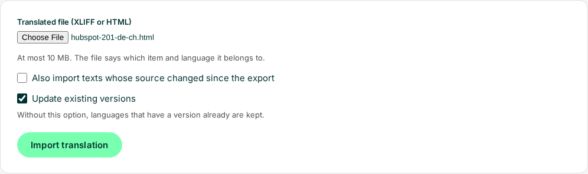
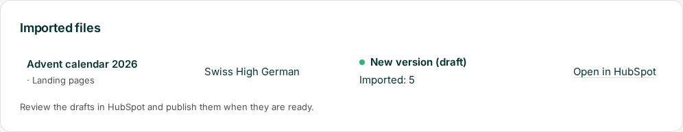

# User guide — Supertext Translation for HubSpot

For editors. Once the app is set up (see [INSTALLATION.md](INSTALLATION.md)), you turn a page, blog post, email or knowledge base article into one version per language. The versions appear in HubSpot as drafts; you review and publish them like any other content.

*Screenshots: the app's pages with a sample account (a Swiss chocolate shop that writes in English and translates into French, German and Italian for Switzerland).*

## Translate

1. Open the app and go to **Translate**.
2. Under **Choose what to translate**, pick the kind of content — *Website pages*, *Landing pages*, *Blog posts*, *Marketing emails* or *Knowledge base* — and the item. The list shows each item's state in HubSpot and its language, and for each of your languages whether it has a version already (*Translated*, a link into HubSpot's editor) or not.
3. Under **Choose the languages**, tick the languages. The code next to each (e.g. `de-CH`) is the variant Supertext translates into.
4. Click **Translate into 2 languages with Supertext**.

   

5. Each language takes a few seconds. The **Translation** box shows the result per language, with a link to each draft in HubSpot. You can leave the page meanwhile; the translation goes on.

   

The list then shows the versions:

Marketing emails work the same way; each language gets its own copy of the email:

The app's pages are in English, German, French or Italian, in your browser's language unless you choose another one under **Settings → Interface language** (for this browser only). They work on a phone too: on a small screen the list of content scrolls sideways to show all your languages.

## Export for translation and import a translated file

Instead of letting Supertext translate right away, you can download an item's texts as a file, have it translated elsewhere (by a translator, in a translation tool such as Trados, memoQ or Phrase, or in Supertext's web app) and import the translated file again. The versions are made exactly as with a Supertext translation. This doesn't use Supertext's API, so it works without an API key.

### Export

1. On **Translate**, choose the item and tick the languages, as for translating.
2. Under **3. Or: Export for translation**, choose the **File format**:
   - **XLIFF 1.2 (for translation tools)**: the better choice for translators and translation tools. One file holds all ticked languages; formatting and personalization tokens appear as protected tags the translator can move but not break.
   - **HTML (one language per file)**: for Supertext's web app or anyone who translates HTML. Tick exactly one language.
3. Click **Download file**. The file is called `hubspot-<item ID>-<language>.xlf` (or `.html`; with several languages `hubspot-<item ID>.xlf`).

   

The file holds exactly the texts the app would send to Supertext (see *What is translated*). If the item has none, you get *Nothing to translate.* and no file.

Send the file to your translator, or upload it to Supertext's web app. In an **HTML file**, the translator must leave the head (the `supertext:` lines), the `data-st-id` attributes and the empty `` placeholders (your personalization tokens) alone, and translate only the text between the tags. An HTML file can't mark a text as "not translated": imported unchanged, it writes the original text into the language version.

### Import

1. Go to **Import translation** (top bar).
2. Choose the **Translated file (XLIFF or HTML)** (at most 10 MB). The file says which item and language it belongs to.
3. Leave **Also import texts whose source changed since the export** off, unless you want translations of texts that were edited in HubSpot after the export.
4. **Update existing versions** works as on the Translate page: ticked, an existing version's draft is replaced; unticked, that language is kept.
5. Click **Import translation**.

   

The page then shows a summary per item and language, with a link to the draft in HubSpot:

| Line | Meaning |
| --- | --- |
| *New version (draft)* / *Draft updated* / *Version exists, kept* | What happened to the language version, as on the Translate page. |
| *Imported: n* | Texts written into the version. |
| *Skipped, source changed since the export: n* | The original text was edited after the export, so the translation may be outdated. Import again with the option ticked to use it anyway. |
| *Not translated in the file: n* | The file has no translation for these texts. |
| *Formatting changed, not imported: n* | The translation broke or added formatting (tags), or lost a personalization token. |
| *Not in the file: n* | Texts added to the item after the export. |

Texts that weren't imported keep what an existing version has there; in a new version they stay in the original language. Nothing is written when no text could be imported.

Errors instead of a summary: *This file isn't a valid XLIFF or HTML translation file.*, *This file wasn't exported by the Supertext app, or its header was removed.*, *The file is too large (at most 10 MB).*, *This file belongs to another system (…)* (exported from another Supertext plugin), *The item this file was exported from no longer exists.* (also for a file from another HubSpot account) and *The site has no language …* (the language was removed under Settings).

## Where the versions go

| Content | In HubSpot |
| --- | --- |
| Website pages, landing pages | A language variant of the page, in the same multi-language group: in HubSpot's page list it appears under the original, and the page editor's language switcher shows it. |
| Blog posts | A language variant of the post, in the blog of that language. The blog needs a language variant for it (your administrator sets that up); otherwise that language fails with HubSpot's message. |
| Marketing emails | A new email named after the original with the language code, for example *Autumn newsletter · DE-CH*, with its language set. Choose its recipients in HubSpot before you send it. |
| Knowledge base articles | A translation of the article, in the knowledge base's version for that language, at the same path. |

Everything is a **draft**: nothing is visible on your website or sent to anyone until you publish or send it in HubSpot.

## Existing versions

Languages that have a version already get a **fresh translation**: **Update existing versions** is ticked when the page opens, and the warning under it reminds you that changes made by hand in HubSpot are replaced. A published page keeps its live version until you publish the new draft. To keep the versions you have (for example after editing a translation by hand), untick it: those languages are then **kept** (*Version exists, kept*) and only missing languages are translated.

An email copy that was sent already is never changed: the next translation makes a new copy.

## Review and publish

Open the version in HubSpot (the *Open in HubSpot* link, or HubSpot's own lists), check the texts, the page title and meta description, the URL (HubSpot gives language variants their own) and, for emails, the subject line, preview text and recipients. Then publish or send it as usual.

**Translation review:** if your administrator turned on *Translation review* for a language, reviewers (your colleagues or Supertext linguists) check and correct the translations on the website. Their corrections come into HubSpot the next time you translate the item into that language with *Update existing versions* ticked: after a review, translate it again. Texts reviewed once keep their corrected wording in later translations.

## What is translated

| | |
| --- | --- |
| Translated | Pages: name, page title, meta description, featured image alt text, and the text of their modules (rich text, headings, buttons, image alt texts, captions …). Blog posts: title, page title, meta description, body, summary, featured image alt text. Emails: subject line, preview text, the text of their modules, the plain-text version and the web version's title and description. Articles: title, subtitle, body, meta description. Bold, italics and links stay where they are; each paragraph is translated as a whole. |
| Kept as it is | HubL and personalization tokens such as `{{ contact.firstname }}` or `{{ unsubscribe_link }}` (put back exactly), link addresses, images, forms, CTAs, styles, layout, the email's sender |
| Not translated | Text in templates and global content (headers, footers), forms and CTAs themselves (translate them in HubSpot), HubDB tables, text marked `translate="no"` or with the class `notranslate`, URLs (slugs) |

The app never changes the original.

## When something goes wrong

The result shows the reason for each language that fails; the other languages still run. Authentication and limit problems stop the whole translation.

| Message | What to do |
| --- | --- |
| *Add your Supertext API key* | An administrator needs to enter the API key under Settings. |
| *Authentication failed* | The API key is no longer valid; tell your administrator. |
| *The language “fr-be” has no Supertext code yet, so nothing was sent* | The language has no Supertext language yet (Supertext has no exact code for it and the app doesn't guess one); nothing was sent to Supertext for it, the other languages still ran. An administrator chooses its code in the *Supertext code* dropdown under Settings → Languages (for example `fr-FR`). On the Translate page such a language shows *No Supertext code yet*. |
| *Supertext offers no formal or informal address for this language* | An administrator sets the form of address to *Let Supertext decide* under Settings → Translation. |
| *Supertext doesn't translate into …* | An administrator checks the language's Supertext code under Settings → Languages. |
| *Supertext returned 2 of 3 personalization tokens or HubL tags; nothing was saved for this language.* | A token got lost in the translation, so nothing was saved (a lost `{{ contact.firstname }}` would show to readers). Translate that language again. |
| *The blog has no “fr-ch” version in HubSpot yet …* | The blog needs that language first: an administrator adds a language variation of the blog in HubSpot (Settings → Content → Blog). Nothing was translated or paid for that language; translate again afterwards. |
| *This is a language version of another item* | Translate the original (primary) instead. |
| *The item has no language in HubSpot …* | Set the page's language in HubSpot, or ask your administrator to set the language of your content. |
| *HubSpot refused the request …* | Your HubSpot subscription may not include this; tell your administrator. |
| *Too many requests* | Wait a moment and start again. Languages already done are kept. |
| *Your Supertext translation limit is exceeded* | Your Supertext plan's volume is used up; tell your administrator. |
| *Your session has expired* / *HubSpot refused the connection* | Connect HubSpot again on the app's start page. |
