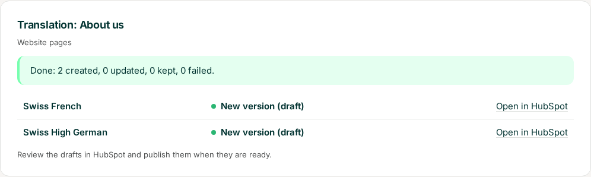
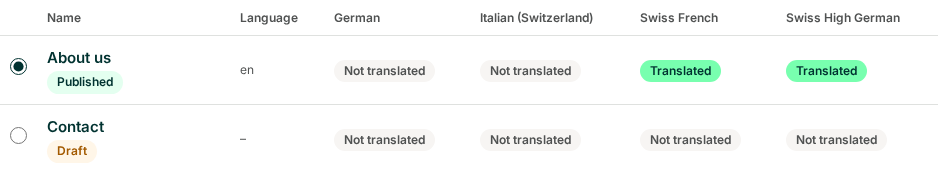
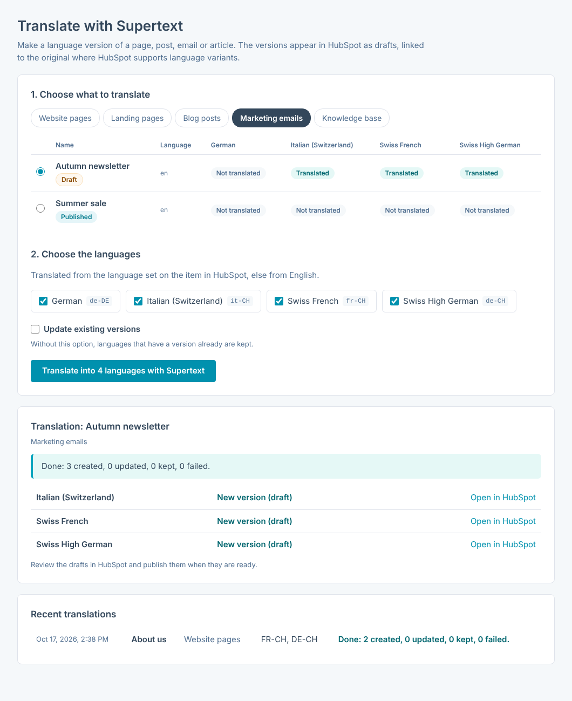
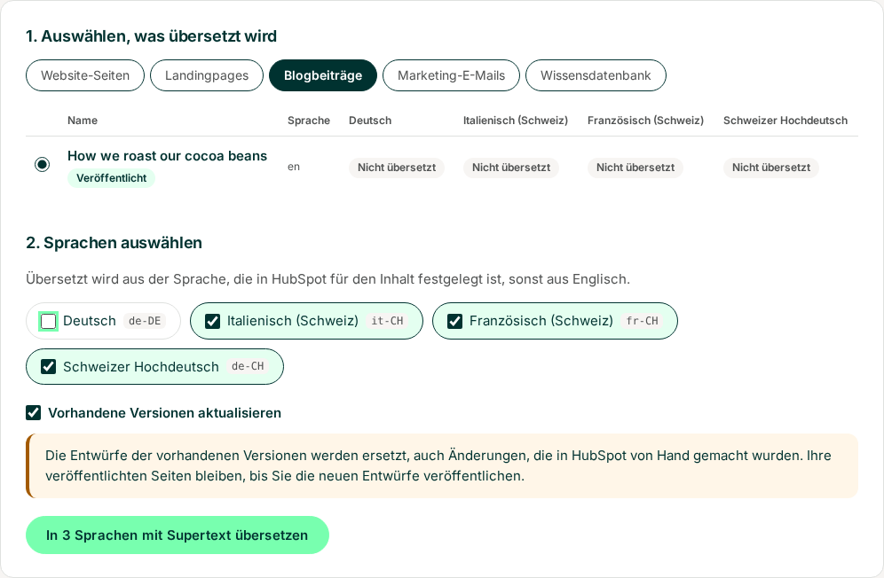
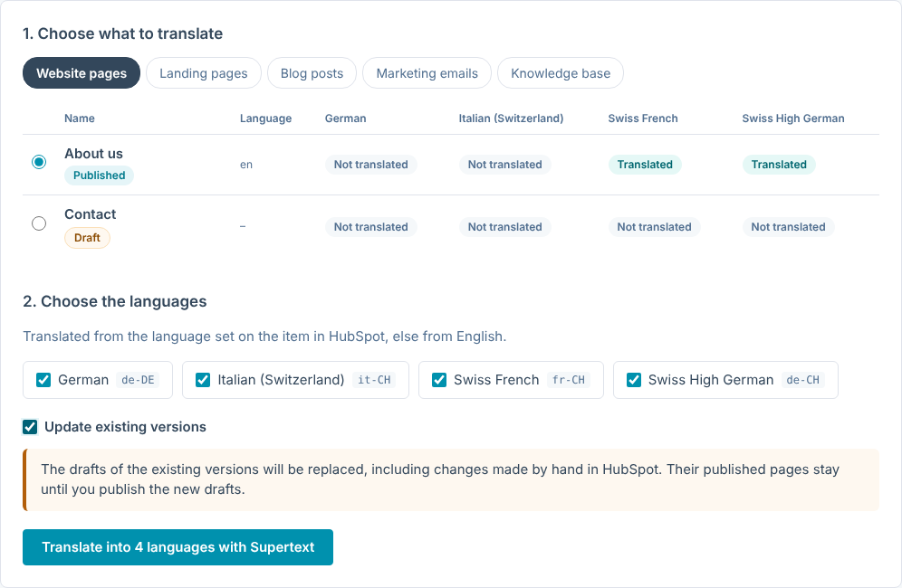

# User guide — Supertext Translation for HubSpot

For editors. Once the app is set up (see [INSTALLATION.md](INSTALLATION.md)), you turn a page, blog post, email or knowledge base article into one version per language. The versions appear in HubSpot as drafts; you review and publish them like any other content.

*Screenshots: the app's pages with a sample account (a Swiss chocolate shop that writes in English and translates into French, German and Italian for Switzerland).*

## Translate

1. Open the app and go to **Translate**.
2. Under **Choose what to translate**, pick the kind of content — *Website pages*, *Landing pages*, *Blog posts*, *Marketing emails* or *Knowledge base* — and the item. The list shows each item's state in HubSpot and its language, and for each of your languages whether it has a version already (*Translated*, a link into HubSpot's editor) or not.
3. Under **Choose the languages**, tick the languages. The code next to each (e.g. `de-CH`) is the variant Supertext translates into.
4. Click **Translate into 2 languages with Supertext**.

   

5. Each language takes a few seconds. The **Translation** box shows the result per language, with a link to each draft in HubSpot. You can leave the page meanwhile; the translation goes on.

   

The list then shows the versions:

Marketing emails work the same way; each language gets its own copy of the email:

The app's pages are in English, German, French or Italian, in your browser's language unless you choose another one under **Settings → Interface language** (for this browser only). They work on a phone too: on a small screen the list of content scrolls sideways to show all your languages.

## Where the versions go

| Content | In HubSpot |
| --- | --- |
| Website pages, landing pages | A language variant of the page, in the same multi-language group: in HubSpot's page list it appears under the original, and the page editor's language switcher shows it. |
| Blog posts | A language variant of the post, in the blog of that language. The blog needs a language variant for it (your administrator sets that up); otherwise that language fails with HubSpot's message. |
| Marketing emails | A new email named after the original with the language code, for example *Autumn newsletter · DE-CH*, with its language set. Choose its recipients in HubSpot before you send it. |
| Knowledge base articles | A translation of the article, in the knowledge base's version for that language, at the same path. |

Everything is a **draft**: nothing is visible on your website or sent to anyone until you publish or send it in HubSpot.

## Existing versions

Languages that have a version already are **kept** (*Version exists, kept*). To replace their drafts with a fresh translation, tick **Update existing versions**. The page warns you first: changes made by hand in HubSpot are lost. A published page keeps its live version until you publish the new draft.

An email copy that was sent already is never changed: the next translation makes a new copy.

## Review and publish

Open the version in HubSpot (the *Open in HubSpot* link, or HubSpot's own lists), check the texts, the page title and meta description, the URL (HubSpot gives language variants their own) and, for emails, the subject line, preview text and recipients. Then publish or send it as usual.

## What is translated

| | |
| --- | --- |
| Translated | Pages: name, page title, meta description, featured image alt text, and the text of their modules (rich text, headings, buttons, image alt texts, captions …). Blog posts: title, page title, meta description, body, summary, featured image alt text. Emails: subject line, preview text, the text of their modules, the plain-text version and the web version's title and description. Articles: title, subtitle, body, meta description. Bold, italics and links stay where they are; each paragraph is translated as a whole. |
| Kept as it is | HubL and personalization tokens such as `{{ contact.firstname }}` or `{{ unsubscribe_link }}` (put back exactly), link addresses, images, forms, CTAs, styles, layout, the email's sender |
| Not translated | Text in templates and global content (headers, footers), forms and CTAs themselves (translate them in HubSpot), HubDB tables, text marked `translate="no"` or with the class `notranslate`, URLs (slugs) |

The app never changes the original.

## When something goes wrong

The result shows the reason for each language that fails; the other languages still run. Authentication and limit problems stop the whole translation.

| Message | What to do |
| --- | --- |
| *Add your Supertext API key* | An administrator needs to enter the API key under Settings. |
| *Authentication failed* | The API key is no longer valid; tell your administrator. |
| *The language “de” has no Supertext code yet, so nothing was sent* | The language isn't mapped to a Supertext language yet; nothing was sent to Supertext for it, the other languages still ran. An administrator enters its Supertext code under Settings → Languages (for example `de-CH`). On the Translate page such a language shows *No Supertext code yet*. |
| *Supertext offers no formal or informal address for this language* | An administrator sets the form of address to *Let Supertext decide* under Settings → Translation. |
| *Supertext doesn't translate into …* | An administrator checks the language's Supertext code under Settings → Languages. |
| *Supertext returned 2 of 3 personalization tokens or HubL tags; nothing was saved for this language.* | A token got lost in the translation, so nothing was saved (a lost `{{ contact.firstname }}` would show to readers). Translate that language again. |
| *The blog has no “fr-ch” version in HubSpot yet …* | The blog needs that language first: an administrator adds a language variation of the blog in HubSpot (Settings → Content → Blog). Nothing was translated or paid for that language; translate again afterwards. |
| *This is a language version of another item* | Translate the original (primary) instead. |
| *The item has no language in HubSpot …* | Set the page's language in HubSpot, or ask your administrator to set the language of your content. |
| *HubSpot refused the request …* | Your HubSpot subscription may not include this; tell your administrator. |
| *Too many requests* | Wait a moment and start again. Languages already done are kept. |
| *Your Supertext translation limit is exceeded* | Your Supertext plan's volume is used up; tell your administrator. |
| *Your session has expired* / *HubSpot refused the connection* | Connect HubSpot again on the app's start page. |
